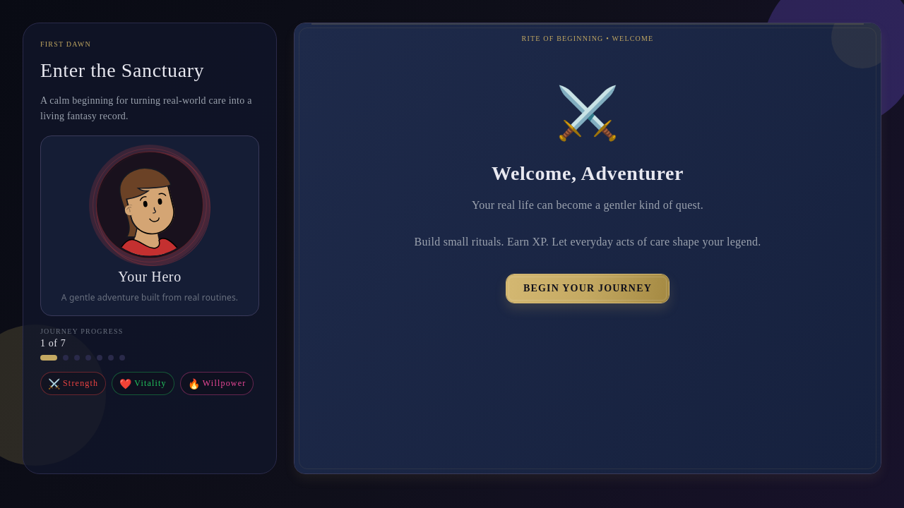
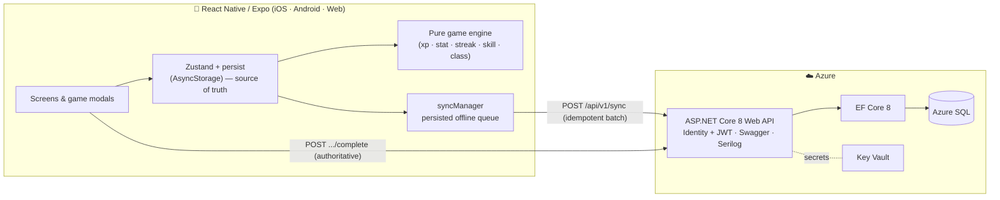

<div align="center">

# ⚔️ Life RPG

**Turn real-life habits into an RPG.** Create a hero, complete quests across six stats, earn XP, level up, unlock skills, and evolve your class through five tiers.

A full-stack project: a **React Native / Expo** mobile + web client backed by an **ASP.NET Core (.NET 8) + EF Core + SQL Server** API on **Azure**, with an offline-first sync layer.

[](https://github.com/sofia-muse/life-rpg/actions/workflows/ci.yml)




### ▶️ **[Try the live demo](https://life-rpg-opal-nine.vercel.app/)**  ·  📱 Android APK: [`eas build -p android --profile preview`](docs/AZURE_DEPLOY.md#client-builds-eas) _(needs live API)_

_The hosted demo runs fully local (no sign-in) so it's instant to try. AI-forged skills + cloud sync run against the .NET API when deployed._

</div>

---

## Highlights

- 🎮 **Complete RPG progression** — 6 stats, an XP curve (`100 × level^1.5`, max level 100), 24 unlockable skills (single-stat + cross-stat), and 30 class titles across 5 tiers.
- 🧠 **Personality-quiz onboarding** that seeds your starting focus stats and quests.
- 🔥 **Streaks & daily rewards** with 8 milestone multipliers (up to 3×).
- 🛡️ **Server-authoritative game logic** — XP, levels, class and skill unlocks are recomputed on the server (anti-cheat); the client computes the same values optimistically for instant, animated feedback.
- 📴 **Offline-first** — local state is the source of truth; a persisted queue flushes to an **idempotent batch-sync** endpoint when back online.
- ✅ **182 automated tests** (72 backend, 110 frontend) with the game engine ported identically to C# and TypeScript, proven equal by golden-value tests.

## Architecture



**Layers (backend):** Clean architecture — `Api → Application → Domain`, `Infrastructure → Application/Domain`, enforced by an architecture test. The `Domain` game engine is a faithful C# port of the client's TypeScript engine, so client and server always agree on progression.

## Tech stack

| Area | Technologies |
|------|-------------|
| **Frontend** | React Native, Expo (Router, typed routes), TypeScript (strict), Zustand + persist, Reanimated, Lottie, react-native-svg |
| **Backend** | C#, ASP.NET Core 8 (Web API), EF Core 8 (Code-First + migrations), ASP.NET Identity + JWT, FluentValidation-style validation, Serilog, Swagger/OpenAPI, rate limiting, health checks |
| **Database** | SQL Server / Azure SQL (JSON columns, rowversion concurrency, unique indexes) |
| **Cloud / DevOps** | Azure App Service, Azure SQL, Key Vault, Application Insights, Bicep (IaC), Azure DevOps pipeline, GitHub Actions CI |
| **Testing** | xUnit + FluentAssertions + WebApplicationFactory (backend) · Jest + jest-expo (frontend) |

## Project layout

```
life-rpg/
├── app/                 # Expo Router screens (tabs, onboarding, auth, modals)
├── src/
│   ├── engine/          # pure game logic (XP, stats, streaks, skills, classes)
│   ├── store/           # Zustand stores (hero, quest, skill, journal, auth, ui)
│   ├── api/             # typed API client, auth, offline sync queue
│   └── config/          # static game data (xp tables, skills, classes, theme)
└── backend/             # ASP.NET Core solution
    ├── src/             # Api · Application · Domain · Infrastructure
    ├── tests/           # unit + integration tests
    └── infra/           # Bicep (Azure resources)
```

## Run it locally

### Frontend (Expo)
```bash
npm install --legacy-peer-deps
cp .env.example .env        # defaults to demo mode (no backend needed)
npm start                   # press w (web), a (Android), i (iOS)
```
By default the app runs in **demo mode** (fully local). Point it at the API by setting `EXPO_PUBLIC_API_URL` and `EXPO_PUBLIC_DEMO_MODE=false` in `.env`.

### Backend (.NET API)
```bash
cd backend
dotnet run --project src/LifeRpg.Api      # Swagger at http://localhost:5005/swagger
```
Runs against a local SQLite database out of the box; configured for SQL Server / Azure SQL in production.

## Testing
```bash
npm run typecheck && npm run lint && npm run test:coverage   # frontend
cd backend && dotnet test                                    # backend
```
- **Frontend:** 125 tests (Jest + jest-expo), engine coverage gated at 80%.
- **Backend:** 72 tests — domain golden-value tests + WebApplicationFactory integration tests (auth, full quest flow, anti-cheat, sync idempotency).

### Android preview build (EAS)

After the Azure API is deployed, build an internal APK:

```bash
npm install -g eas-cli && eas login
eas build -p android --profile preview
```

See [docs/AZURE_DEPLOY.md](docs/AZURE_DEPLOY.md) for infrastructure and env vars (`EXPO_PUBLIC_API_URL`, `EXPO_PUBLIC_DEMO_MODE=false`).

## Design decisions

### Enchanted forest interface

The interface uses illustrated forest chapter headers, quiet evergreen reading surfaces, warm parchment task rows, and larger supporting text. Artwork stays out of task content. The home screen puts daily quests first and keeps the share card behind an explicit toggle. Heroes can choose two detailed painted fantasy portraits, or switch to the customizable SVG illustration with saved skin, hair, expression, and glasses choices. Painted portraits, 18 custom fantasy medallions for attributes, adventures, and rituals, and the forest scene are AI-generated project assets in `assets/storybook/`. Evergreen panels use restrained gold botanical corners, while parchment quest rows retain clear text.

The character editor uses a single vertical scroll on small screens. Web sharing offers an explicit text preview and copy fallback. Native-only reminders and haptics are explained and disabled in the browser. Campaign chapters resume existing bosses instead of duplicating them.

- **Offline-first, server-validated.** The client applies XP optimistically for snappy UX; the server recomputes from the same engine and is the source of truth. Shared constants keep them identical (verified by tests).
- **Idempotent sync.** Each queued operation carries a stable `opId` logged server-side, so replaying a batch after a flaky connection is a no-op.
- **Secrets via Key Vault.** No connection strings or signing keys in the repo; the App Service reads them through Key Vault references using a managed identity.

### Reliable progress and the first story

Completion facts are persisted separately from mutable quest cards. Weekly path credit uses those facts, so daily resets and removed tasks do not erase earned credit. Existing saves import only their known completion timestamps; unknown historical dates are not invented. Account mode exposes completion history through the API.

Rest-day rewards are guarded once per UTC day. Online rest/login rewards use idempotent server commands; generic hero sync no longer accepts progression counters or XP. Quest rewards advance streak before calculation in both modes. The sync response marks a complete quest snapshot; the client also merges older delta responses safely, retains pending edits and conflicts, and exposes retry status in Settings.

The Starlit Library is a five-day reading chapter in the World Map. The player chooses a reading goal and session length, explicitly swaps an active habit if all daily slots are occupied, and restores one lantern per reading day. Days need not be consecutive; completion unlocks a unique equippable title once. The story run is device-local for now, and daily boundaries use UTC; both limits are stated in the chapter.

### Custom icon set

The 18-icon storybook set uses three bundled WebP atlases: attributes-v2, adventure-v2, and rituals-v2. RPGIcon maps semantic names to sprites; FantasyIcon remains the stat-specific wrapper. Existing achievement and generated skill metadata is mapped through LegacyRPGIcon, so saved records keep their IDs and effects. Small controls and crest selectors use custom gold SVG linework. Navigation, journal, codex, rewards, quests, achievements and avatar controls use the coordinated set; share text remains readable plain text.

## License
MIT — see [LICENSE](LICENSE).


### Storybook controls and typography

Buttons, cards, headers and region tiles share the engraved `StoryFrame` ornament. Decorative borders never handle touches or expose screen-reader content. Reward dialogs scroll on shorter screens. App text and inputs use the shared `StoryText` components; use those instead of importing native Text/TextInput for future screens.

Fonts are bundled locally with SIL Open Font License notices in assets/fonts. Headings use a static semibold instance of [Cormorant Garamond](https://github.com/google/fonts/tree/main/ofl/cormorantgaramond); body text uses regular, medium, bold and italic [Alegreya Sans](https://github.com/google/fonts/tree/main/ofl/alegreyasans). Both include Cyrillic glyphs. The display file is instantiated at weight 600 from the upstream variable font. A font loading error releases the startup gate so the app can still open using platform fallback rendering.
